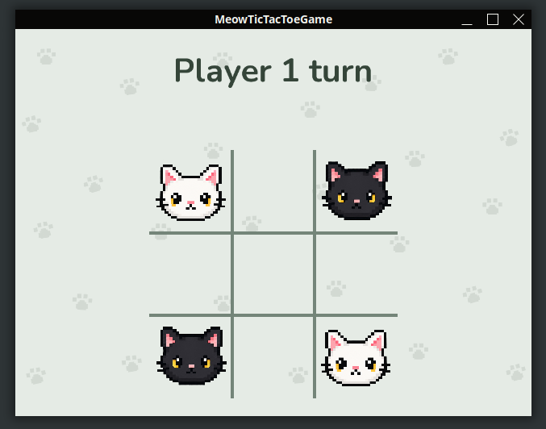

# Meow TicTacToe Game

<p align="center">
  
</p>

Projeto desenvolvido em Java utilizando o framework LibGDX, com o objetivo de praticar desenvolvimento de jogos, implementação de lógica de programação, programação orientada a objetos, renderização gráfica e integração de recursos de áudio.

## Descrição

O **Meow TicTacToe Game** é uma versão do clássico jogo da velha, com uma identidade visual inspirada em uma estética cozy e minimalista. Em vez dos tradicionais símbolos X e O, os jogadores utilizam gatos em pixel art para representar suas jogadas.

O jogo conta com uma interface personalizada, incluindo paleta de cores suaves, textura de fundo, fonte personalizada, música ambiente e efeitos sonoros.

Os jogadores podem:

- Realizar jogadas em um tabuleiro 3x3
- Alternar as jogadas entre dois jogadores
- Identificar automaticamente uma vitória ou empate
- Ouvir música ambiente durante as partidas, efeitos sonoros durante as jogadas e ao finalizar a partida
- Reiniciar a partida utilizando a tecla R

## Tecnologias utilizadas

- **Java** – Linguagem principal
- **LibGDX** – Framework para desenvolvimento de jogos
- **LWJGL3** – Backend para execução da aplicação desktop
- **FreeType** – Renderização de fontes personalizadas
- **Gradle** – Gerenciador de dependências e build

## Como rodar o projeto

### 1. Clone o repositório

```bash
git clone https://github.com/JessicaLorenzon/meow-tic-tac-toe-game.git
```

### 2. Acesse a pasta do projeto

### 3. Inicie a aplicação

No Linux/macOS:

```bash
./gradlew lwjgl3:run
```

No Windows:

```bash
gradlew.bat lwjgl3:run
```
